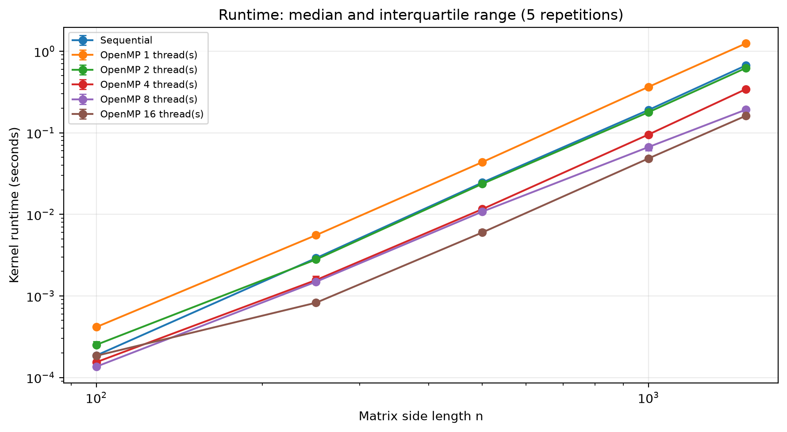
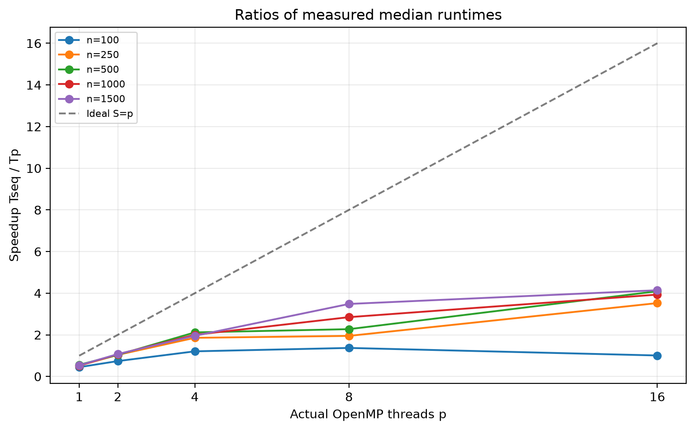
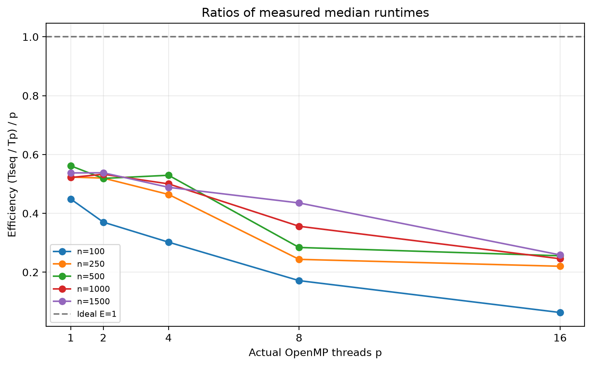
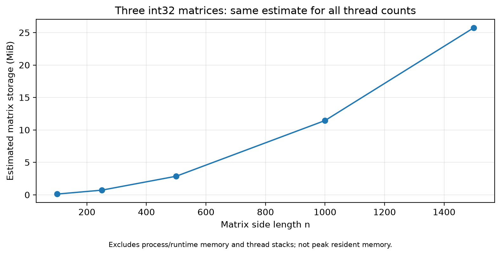
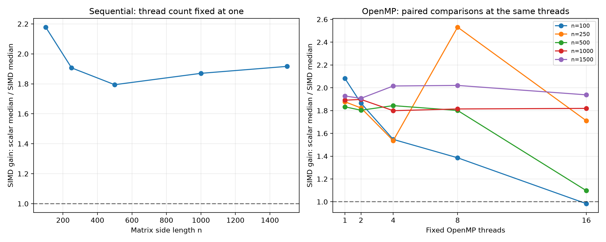
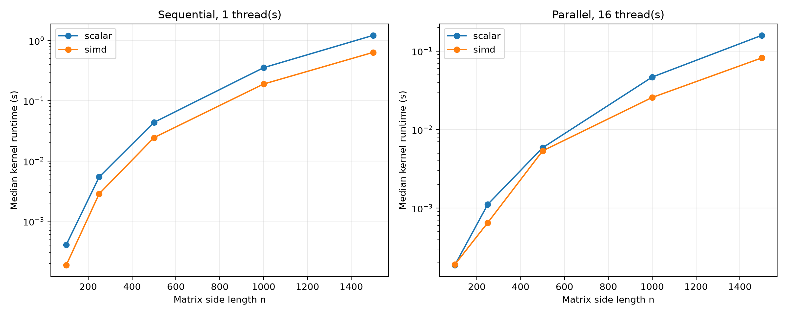

# Big Data - Assignment 3

## Parallel Matrix Multiplication and Optional SIMD Vectorisation

This project studies how matrix size and thread count affect runtime, memory,
speedup and efficiency for shared-memory multiplication. It compares equivalent
sequential and OpenMP implementations, then evaluates SIMD at fixed thread
counts in a separate controlled experiment.

**Status:** implementations, correctness checks, raw measurements and analysis
are complete. The English PDF research report is still pending; this README
does not replace it.

## Project structure

```text
c/
  matrix_sequential.c          Sequential i-k-j kernel
  matrix_parallel.c            OpenMP row-parallel kernel, optional SIMD
  matrix_common.h              CSV I/O, validation and benchmark harness
experiments/
  config.json                  Sizes, threads, OpenMP settings and budgets
  PROTOCOL.md                  Mandatory experimental design
  SIMD_PROTOCOL.md             Optional vectorisation design
  generate_matrix.py           Original small-input generator
  check_correctness.py         Independent full-output correctness checks
  run_experiments.py           Mandatory campaign runner
  analyze_results.py           Mandatory tables and plots
  build_simd.py                Scalar/SIMD builds and compiler evidence
  run_simd_experiments.py       Optional campaign runner
  analyze_simd.py               Fixed-thread SIMD comparisons
results/
  runs/                        Mandatory raw measurements and metadata
  analysis/                    Mandatory statistics and four figures
  simd/build/                  Compiler reports, assembly and build metadata
  simd/runs/                   Optional measurements, evidence and analysis
requirements.txt               Plotting dependency
```

Generated inputs, binaries and exploratory output matrices are ignored by Git.
Raw campaign data, diagnostics and analysis outputs are tracked.

## Environment and dependencies

Run the commands below in **PowerShell from the repository root**. The runners
target Windows, use PowerShell/CIM to query hardware and execute .exe binaries.
They are not unchanged cross-platform automation scripts.

| Component | Recorded configuration |
|---|---|
| CPU | AMD Ryzen 7 6800HS with Radeon Graphics |
| Physical cores / logical processors | 8 / 16 |
| RAM | 16,387,997,696 bytes (approximately 15.26 GiB) |
| Operating system | Windows 11 Home, 10.0.22631 |
| Compiler | GCC 16.2.0, MSYS2 UCRT64, revision 6 |
| Python used for measurement | 3.12.14 |
| Plotting | Matplotlib 3.11.2 |
| Numeric representation | 32-bit C int, contiguous row-major arrays |

GCC, libgomp and the compiler runtime DLLs must be available on PATH. If linking
fails with `cannot find -lgomp`, install the matching runtime in MSYS2 UCRT64:

```bash
pacman -S --needed mingw-w64-ucrt-x86_64-libgomp
```

Generation, validation and measurement need only Python's standard library.
Install the plotting dependency to regenerate figures:

```powershell
python -m pip install -r requirements.txt
```

Exact machine/tool versions, compiler flags, input/source hashes and correctness
outcomes are retained in each campaign's environment.json.

## Build and validate

```powershell
New-Item -ItemType Directory -Force build, results | Out-Null
gcc -O2 -Wall -Wextra -Werror -fopenmp c/matrix_sequential.c -o build/matrix_sequential.exe
gcc -O2 -Wall -Wextra -Werror -fopenmp c/matrix_parallel.c -o build/matrix_parallel.exe
python experiments/check_correctness.py
python experiments/generate_matrix.py
./build/matrix_sequential.exe 100
./build/matrix_parallel.exe 100 4
```

Both programs use identical flags. The sequential kernel creates no OpenMP
parallel region. The standalone generator creates sizes 10, 50, 100, 250, 500;
the campaign runners generate their own full sequence, including 1000 and 1500.

The checker compares every output element against an independent Python i-j-k
reference. Known-answer, zero, identity and seeded random tests include sizes
1, 7, 32 and 33 and parallel thread counts 1, 2, 4: 28 full-output checks.
The optional scalar and SIMD variants each pass those checks (56 in total),
including odd dimensions that exercise vector tails.

## Algorithm, inputs and safety

Both kernels use O(n^3) i-k-j multiplication and initialise each output row before
accumulation. OpenMP assigns complete rows using schedule(static); workers never
update the same C element. A and B are read-only, separately allocated arrays.
A single construct records the actual team size; synchronisation completes
before results are consumed.

Inputs use Python random.Random(42), reset per size, generating A then B with
integer values from 0 through 10 inclusive. All methods share identical CSV
inputs; SHA-256 hashes are saved. Values outside [0,10] are rejected. The code
enforces `100*n <= INT_MAX` and a safe allocation-size bound, preventing signed
arithmetic overflow on the recorded platform. Correctness uses exact integer
equality; floating-point tolerances are unnecessary.

## Mandatory experiment

```powershell
python experiments/run_experiments.py --dry-run
python experiments/run_experiments.py
```

The runner builds, checks correctness, records current hardware, generates
inputs and creates a new timestamped directory under results/runs/.

| Setting | Value |
|---|---|
| Side lengths n | 100, 250, 500, 1000, 1500 |
| Parallel threads p | 1, 2, 4, 8, 16 |
| Configurations / measured samples | 30 / 150 |
| Warm-ups / measured repetitions per configuration | 2 excluded / 5 retained |
| Configuration order | Shuffled, seed 2026 |
| Compiler flags | -O2 -Wall -Wextra -Werror -fopenmp |
| Process timeout | 60 seconds, including I/O, warm-ups and output |
| Campaign execution budget | 600 seconds, excluding setup and input generation |
| Matrix-storage budget | 256 MiB |

Inherited OpenMP controls are removed. Settings are OMP_DYNAMIC=FALSE,
OMP_PROC_BIND=FALSE, OMP_WAIT_POLICY=PASSIVE, OMP_THREAD_LIMIT=16 and
OMP_MAX_ACTIVE_LEVELS=1. No explicit CPU affinity is pinned. Actual team sizes
are recorded and checked. Sixteen logical processors are not sixteen physical
cores. No oversubscription or internally threaded BLAS library is used.

### Timing, memory and raw output

On Windows the main thread uses QueryPerformanceCounter, with frequency
initialised outside the timer. Other platforms use omp_get_wtime in the C
harness. Timing includes output initialisation, multiplication and OpenMP
region/scheduling/synchronisation overhead. Allocation, input validation, CSV
I/O and checksum calculation are excluded. Every run's full result is consumed
by a checksum; the final matrix is saved after all runs.

The executable prints headerless lines in this order:

```text
RESULT,method,size,requested_threads,actual_threads,repetition,seconds,checksum
```

Each campaign retains raw.csv, status.csv, environment.json and original
stdout/stderr. Raw CSV also identifies numeric type and matrix storage; optional
CSV adds the variant. Failures/timeouts retain diagnostics and receive no
invented runtime. Configurations are marked unattempted if the campaign budget
is exhausted.

Memory is the **estimated storage of three matrices**, `12*n*n` bytes, using
32-bit integers. It excludes allocator overhead, runtime and thread stacks;
it is **not peak process resident memory** and cannot quantify thread-related
process-memory growth. Size 1500 needs 27,000,000 bytes (25.75 MiB), below budget.
It is the largest attempted and completed planned size, not an absolute machine
capacity limit. All configurations in both completed campaigns finished without
failure or timeout.

### Recorded results and reproducible analysis

- [Completed mandatory campaign](results/runs/20261111T181210712569Z/): 150 samples.
- [Incomplete diagnostic campaign](results/runs/20261111T181024705566Z/): retained
  after the original Windows OpenMP timer returned a zero duration. It is
  excluded from analysis; both programs now use the high-resolution timer.
- [Mandatory statistics](results/analysis/summary.csv).
- [Mandatory interpretation and limitations](results/analysis/RESULTS.md).
- [Detailed experimental protocol](experiments/PROTOCOL.md).

Regenerate the committed analysis without rerunning measurements:

```powershell
python experiments/analyze_results.py --run results/runs/20261111T181210712569Z
```

To analyse a newly generated campaign, substitute its exact timestamped folder.
The analyser rejects incomplete campaigns. It reports median, inclusive
interpolated quartiles, IQR (Q3-Q1), min/max and repetitions. IQR describes spread,
not a confidence interval. Metrics use ratios of medians:

```text
S(p) = median(Tseq) / median(Tp)
E(p) = S(p) / p
```

At n=1500 the sequential median is **0.6674046 s**, versus **0.1611506 s** with
16 threads: **4.14x speedup** and **25.9% efficiency**. The one-thread parallel
median is about 1.86 times the sequential median. This reveals implementation/
framework overhead but does not isolate its cause as thread creation alone;
compiler code generation and runtime behaviour may also contribute. No
superlinear speedup was observed in this campaign.









## Optional SIMD extension

ENABLE_SIMD enables an OpenMP simd directive on the inner j loop, whose
iterations update distinct output columns without loop-carried dependencies.
Ordinary builds do not enable this explicit directive. Mandatory -O2 builds
are not claimed to disable automatic vectorisation and are **not the scalar
control** for this extension.

Both optional variants use -O2 -Wall -Wextra -Werror -fopenmp
-fno-tree-slp-vectorize. Their additional treatment flags are:

| Variant | Additional flags |
|---|---|
| Scalar | -fno-tree-loop-vectorize |
| SIMD | -ftree-loop-vectorize -DENABLE_SIMD |

```powershell
python experiments/build_simd.py
python experiments/run_simd_experiments.py
python experiments/analyze_simd.py --run results/simd/runs/20261111T182818811129Z
```

The first command builds and validates without measuring performance. The
runner also rebuilds and checks before its campaign. The final command analyses
the committed campaign; for a new campaign substitute its exact folder.

[Compiler reports and assembly](results/simd/build/) establish that the
multiplication loop is vectorised using 16-byte vectors, including packed
multiply/add instructions. Scalar reports show no successful vectorisations.
The checksum may also be vectorised but is outside the measured region.
The treatment includes compiler loop transformations, not just instruction
latency. See the [SIMD protocol](experiments/SIMD_PROTOCOL.md).

The [optional campaign](results/simd/runs/20261111T182818811129Z/) contains
60 completed configurations and 300 samples. It snapshots compiler evidence
in build_evidence/ and retains exact per-variant flags. Timing boundaries,
inputs, sizes, warm-ups, repetitions, budgets and thread settings match the
mandatory design. Optional and mandatory measurements are never pooled.

SIMD gain is `median(Tscalar) / median(Tsimd)` at the **same size, method and
thread count**. It is separate from thread speedup. For n=1500 it is **1.92x
in sequential execution** and **1.94x with 16 threads**. Small cases do not
necessarily benefit: n=100 at 16 threads has gain near one.

- [All SIMD paired statistics and IQRs](results/simd/runs/20261111T182818811129Z/analysis/summary.csv).
- [Optional interpretation](results/simd/runs/20261111T182818811129Z/analysis/RESULTS.md).





## Limitations

One campaign per study and five samples per configuration limit uncertainty
assessment. Background load and CPU frequency were not controlled; affinity
was not pinned. Short small-size timings limit fine-grained comparisons. Ratio
plots do not include propagated uncertainty; inspect IQR and original samples.
The observations alone do not isolate cache, bandwidth or scheduling
bottlenecks. Matrix-storage estimates are not peak process-memory measurements.
Conclusions apply to the tested implementations, inputs, flags and hardware.

## Reused materials and AI assistance

The i-k-j kernel and CSV utilities derive from Assignment 2 commit
`1c42becb273ed649c89d91101fe40d9ec36ca059`, file c/matrix_loop_reordering.c.
Here they were adapted for per-row initialisation, a shared elapsed-time
harness, OpenMP and optional SIMD. The standalone generate_matrix.py remains
unchanged from that commit; campaign runners use the same generation procedure
for their configured sizes. Assignment 2 was read only and not modified.

Codex (OpenAI) assisted with experimental planning, implementation, correctness
checks, measurement and analysis scripts, execution of real measurements,
figures and documentation. Affected parts are the Assignment 3 code, tooling,
analysis outputs and README. Measurements are actual program outputs; generated
text is not experimental evidence. The student must understand the code,
validate results and references and explain the conclusions. Git commits are
reviewed and created by the student.

## Technical references

- [GCC OpenMP options](https://gcc.gnu.org/onlinedocs/gcc/OpenMP-and-OpenACC-Options.html)
- [GCC optimisation and vectorisation](https://gcc.gnu.org/onlinedocs/gcc/Optimize-Options.html)
- [GCC diagnostic options](https://gcc.gnu.org/onlinedocs/gcc/Developer-Options.html)
- [Windows high-resolution timestamps](https://learn.microsoft.com/en-us/windows/win32/sysinfo/acquiring-high-resolution-time-stamps)
